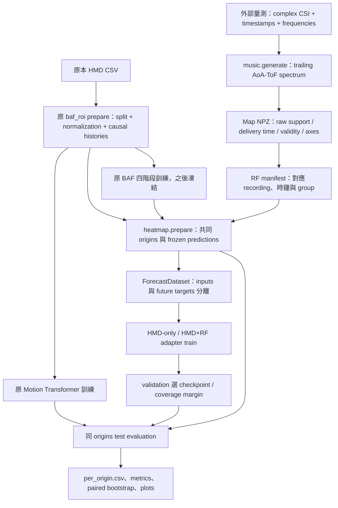

# Heatmap Extension：完整架構、資料契約與操作

演算法與理由見 [ALGORITHM](README_HEATMAP_ALGORITHM.md)，實驗解讀見 [EVALUATION](README_HEATMAP_EVALUATION.md)。本文件說明真正實作的邊界，不把尚未接上的硬體或 renderer 畫成已完成系統。

## 1. 系統資料流



Online path 是：observed HMD + 已完成且可取得的 map → 原 BAF forecast → adapter → hard ROI。硬體 acquisition、clock synchronization、網路與渲染器在套件外；本版 RF store 是 NPZ snapshot，不是假裝存在的持續更新感測 driver。

## 2. 檔案與 function 分工

```text
baf_roi/                         原 HMD-only baseline，不修改
motion_transformer_roi/          原 Motion Transformer，不修改
vendor/                          原作者模型與 utilities，不修改
baf_roi_heatmap/
  contracts.py                   config、hash、JSON、seed、輸出保護
  music.py                       numeric trailing-window MUSIC generator
  data.py                        RF 契約、對齊、normalization、dataset
  manifest.py                    需核對的 recording / clock mapping 模板
  prepare.py                     frozen BAF/F/E/fixed rollouts + GT cache
  model.py                       HMD/RF encoders、residual / expert_gate
  losses.py                      pose + soft ROI loss、精確 fallback
  train.py                       adapter 訓練與 validation checkpoint
  runtime.py                     online prediction API 與 batch-one benchmark
  evaluation.py                  metrics、MT、margin policy、paired comparison
  diagnostics.py                 hindsight candidate oracle、plots
  __main__.py                    CLI
scripts/
  smoke_heatmap.py                完整 synthetic integration test
  check_heatmap_reference.py      與使用者原 MUSIC.py 數值對照
configs/heatmap_*.example.json    明示預設；不是硬體驗證結果
tests/heatmap/                    因果性、缺測、資料切分、數值測試
.github/workflows/heatmap-tests.yml
```

| Module / function | 輸入 → 輸出 | 不應負責的事 |
|---|---|---|
| `music.validate_csi` | complex CSI/times/frequencies → validated arrays | 猜測 packet rate 或 radio channel |
| `music.steering_rows` | axes/aperture/convention → steering matrix | 把 legacy angle 直接當人體方位 |
| `music.smooth_covariance` | completed raw window → smoothed covariance | 看後續 packets |
| `music.music_spectrum` | covariance/noise subspace → linear spectrum | 自動辨識人數或 body parts |
| `music.generate` | raw NPZ/config → map NPZ + audit JSON | 硬體 phase calibration |
| `data.HeatmapSeries` | map NPZ/clock mapping → validated RF series | 修改 split 或自動校準時鐘 |
| `data.encode_window` | series/origin/train stats → maps/mask/timing/availability | 使用 future map 補值 |
| `data.fit_normalizer` | RF manifest → training-only median/MAD | 在 test 重新 fit |
| `data.load_rf_manifest` | manifest/HMD cache → validated mapping | 把同人的不同 session 當成不同 subject |
| `prepare.observed_weights` | chronological confidence → original observed EMA | commit recursive virtual states |
| `prepare.fixed_forecast` | observed history/fixed α → independent recursive trajectory | 用 GT pose teacher forcing |
| `prepare.prepare` | cache/checkpoint/RF/scene → frozen paired task cache | adapter 訓練或 test tuning |
| `data.ForecastDataset` | prepared cache/split → inputs + separate supervision | 把 target 混入 forward |
| `model.ForecastAdapter` | causal inputs → corrected pose/gate/penalty | 更新 frozen BAF parameters |
| `losses.task_loss` | predictions + supervision → scalar loss | 最終 test quality 判定 |
| `train.train` | train/valid data → adapter.pt | 用 test 選 epoch |
| `runtime.HeatmapPredictor` | observed HMD/RF → future corrected poses | 自行讀未來 radio data |
| `evaluation.evaluate` | exact origins/method → CSV/report | 靜默移除難預測樣本 |
| `evaluation.select_policy` | validation sweep → frozen margin policy | 根據 test 調門檻 |
| `evaluation.compare` | matched method results → paired cluster CI | 把每個重疊 window 當獨立受試者 |
| `diagnostics.oracle` | finite candidates + offline GT → headroom diagnostic | 可部署的 inference policy |

## 3. Raw CSI NPZ 契約

必須使用 `allow_pickle=False` 可讀的數值陣列：

| Key | Shape/type | 定義 |
|---|---|---|
| `csi` | complex `[N,Tx,Rx,K]` | 保留 phase；原 magnitude-only 資料不能還原 phase |
| `timestamps_s` | float64 `[N]` | raw packet observation time，嚴格遞增 |
| `available_at_s` | float64 `[N]` | raw packet 在處理端可取得的時間，同 clock，至少 timestamp |
| `frequencies_hz` | float64 `[K]` | 每個保留 subcarrier 的實際頻率 |

`subcarrier_indices` 可在 generator config 選取均勻頻率子集。選取後仍不均勻就拒絕，不能在缺失/DC subcarrier 上假裝均勻。

```python
# These arrays must come from the recorder / calibrated radio metadata.
import numpy as np
np.savez_compressed(
    'data/radio_record.npz',
    csi=complex_csi,
    timestamps_s=packet_observation_times,
    available_at_s=packet_receive_times,
    frequencies_hz=actual_subcarrier_frequencies,
)
```

只有 raw CSI 而沒有 timestamps / frequency mapping 時，程式有意不猜測。應先修 recorder；不能把 `np.arange(N)/100` 當成實測時鐘，除非它只是明確標示的模擬。

## 4. Map NPZ 契約

| Key | Shape | 意義 |
|---|---|---|
| `maps` | `[F,A,D]` | linear 或 dB numeric MUSIC spectrum |
| `valid` | `[F]` bool | gap／零 covariance 等品質判定 |
| `support_start_s` / `support_end_s` | `[F]` | 所有實際用到的 raw support |
| `available_at_s` | `[F]` | map 完成可交付的時間 |
| `theta_deg` | `[A]` | angle grid，必須記錄 convention |
| `tau_s` | `[D]` | delay grid，單位秒 |
| `metadata_json` | Unicode scalar | 下方 metadata |
| `processing_s` | `[F]`，generator 輸出 | 本機生成耗時，不等於歷史量測 latency |

Metadata 至少包含 `format_version=1`、`representation="aoa_tof"`、`unit="linear"|"db"`、`clock_domain`、`availability_source`、`physical_axes_verified`。新 generator 另附原 raw SHA256 與完整 config。

`physical_axes_verified=true` 是使用者完成外部校正後的宣告，不是程式幫忙證明校正。預設 false。探索未校準表示時必須在 RF manifest 明示 `allow_exploratory=true`，報告不可宣稱準確物理 AoA/ToF。

## 5. RF manifest：一段 HMD 必須對應哪段 RF

```json
{
  "format_version": 1,
  "hmd_cache_id": "COPY_THE_REAL_CACHE_ID",
  "hmd_clock_domain": "unix_seconds",
  "synchronization_confirmed": false,
  "allow_exploratory": false,
  "records": [
    {
      "key": "trajectory_00000",
      "file": "maps/record_01.npz",
      "source_clock_domain": "radio_clock_seconds",
      "clock_offset_s": 0.0,
      "clock_uncertainty_s": 999.0,
      "group_id": "participant_01",
      "scenario": "workout"
    }
  ]
}
```

這只是格式，不是可直接拿去做正式實驗的同步參數。程式採 `HMD_time = RF_time + clock_offset_s`；若是不同 oscillator 且有 drift，必須先在外部完成 clock mapping 並輸出映射後 timestamps，不能只填常數 offset 就忽略 drift。

每一個 HMD cache trajectory key 必須出現恰好一次。沒有 RF 的 record 用 `file:null`，仍保留在 test，依 fallback 評估。`group_id` 應使用真正 subject identity（跨其 sessions 一致）；不知道 subject 時只能用 session，並限縮泛化主張。該 group 不得跨 train/valid/test。相同 map bytes 或相同 raw-source SHA 的重新處理版本也不得跨 split。

`scenario` 只有真實標註存在時才填；`unspecified` 時不輸出假造 scenario-macro。Nymeria 的六活動 scenarios 與 VR 裡的六個 virtual streams 是不同概念，不要互相填入。

## 6. Prepared experiment 的內容

```text
prepared/
  manifest.json
  frozen/
    trajectory_00000.npz
    trajectory_00001.npz
    ...
```

`manifest.json` 鎖定 pose cache ID、checkpoint SHA256、train/valid/test、RF 檔案 hashes、clock mapping、input config、scene snapshot/partition IDs、normalizer、horizons 與 experiment_id。

Frozen NPZ 儲存 anchors、absolute origin_s、original observed alpha、BAF/F/E/fixed future p/q、target p/q、target mask。Future arrays 只走 `supervision`；`model.forward` 只吃 `inputs`。Dataset 讀檔時核對 hash，避免 prepare 後悄悄改資料。

Cache 路徑是絕對路徑，並非完整自包含資料包。移機應在新機重新 prepare；不要手改 manifest 來繞過 experiment identity。資料可能很大，frozen arrays/RF series 使用有限 LRU；目前單 record 的 map NPZ 仍整份載入，長錄影應分段並保留 group 不跨 splits。

## 7. 完整離線流程

### 7.1 沿用 HMD baseline

核對原 `configs/default.json` 的 dataset root、position unit、rotation convention、scene geometry 與 split，再執行：

```bash
python -m baf_roi prepare --config configs/default.json --output cache/experiment01
python -m baf_roi train --cache cache/experiment01 --output runs/experiment01 --device auto
python -m motion_transformer_roi train --cache cache/experiment01 --output runs/mt_experiment01 --device auto
```

已有相同 cache 的有效 checkpoint 就重用，不需為 adapter 任意重訓原 experts。若 cache/切分改變則原 checkpoints 必須重新訓練；HMD資料與RF資料必須是同一次量測，不可把 Nymeria 動作任意配上另一場 radio recording。

### 7.2 生成 maps 與核對 manifest

```bash
python -m baf_roi_heatmap generate --raw data/radio_record.npz --config configs/heatmap_generator.example.json --output data/maps/record_01.npz
python -m baf_roi_heatmap manifest-template --cache cache/experiment01 --maps-directory data/maps --output data/rf_manifest.json
```

Template 只會自動對上 `trajectory_<id>.npz` 名稱；其他檔名需核對填入。`expected_map_path` 是提示，不是不存在的檔案也能載入。逐 record 記錄外部同步與校正證據。

### 7.3 鎖定共同 origins / horizons / scene

```bash
python -m baf_roi_heatmap prepare --cache cache/experiment01 --baseline runs/experiment01/baf_roi.pt --rf-manifest data/rf_manifest.json --input-config configs/heatmap_input.example.json --output runs/heatmap_prepared --horizons 50 100 150 200 250 400 600 800 1000 --device cpu
```

新 CLI 的 `--device` 使用 `cpu`、`cuda`、`cuda:0`，不解析 `auto`。要更換 scene 可加入 `--scene-config configs/scene.json`，內部路徑相對該 config 解析。所有 methods 在此 prepare 的相同 scene 上評估；training ROI loss 也使用它。

### 7.4 訓練四種主要方法與 representation ablations

```bash
for method in residual expert_gate; do
  for modality in hmd rf; do
    python -m baf_roi_heatmap train --prepared runs/heatmap_prepared --method "$method" --modality "$modality" --seed 42 --epochs 20 --output "runs/${method}_${modality}_42"
  done
done
python -m baf_roi_heatmap train --prepared runs/heatmap_prepared --method residual --modality rf --ablation metadata_only --seed 42 --output runs/metadata_only_42
python -m baf_roi_heatmap train --prepared runs/heatmap_prepared --method residual --modality rf --ablation last_frame --seed 42 --output runs/last_frame_42
python -m baf_roi_heatmap train --prepared runs/heatmap_prepared --method residual --modality rf --ablation spatial_mean --seed 42 --output runs/spatial_mean_42
```

其他 `--ablation`：angle_only、delay_only、abs_change。需要重新訓練各消融，不能只在 test 隨意移除輸入後當成公平 model comparison。再重複 seeds 43、44；不要挑最好的一個 seed 報告。`--roi-weight 0` 是 pose-only objective 消融。

### 7.5 相同資料上評估

```bash
for method in baf focused explorer fixed; do
  python -m baf_roi_heatmap evaluate --prepared runs/heatmap_prepared --baseline "$method" --output "runs/eval_${method}"
done
python -m baf_roi_heatmap evaluate --prepared runs/heatmap_prepared --motion-transformer runs/mt_experiment01/motion_transformer_roi.pt --output runs/eval_mt
python -m baf_roi_heatmap evaluate --prepared runs/heatmap_prepared --checkpoint runs/residual_hmd_42/adapter.pt --output runs/eval_hmd_42
python -m baf_roi_heatmap evaluate --prepared runs/heatmap_prepared --checkpoint runs/residual_rf_42/adapter.pt --output runs/eval_rf_42
python -m baf_roi_heatmap compare --left runs/eval_hmd_42 --right runs/eval_rf_42 --output runs/paired_42.json
python -m baf_roi_heatmap plot --evaluations runs/eval_baf runs/eval_mt runs/eval_hmd_42 runs/eval_rf_42 --output runs/plots_42
```

輸出 `per_origin.csv` 與 `report.json`。MT checkpoint 必須同 cache ID / normalization；不會重新採樣不同的 origins。MT 的 `gate` 欄空白，因為它沒有 expert weight；residual 的 gate 欄只是原 BAF α 診斷值，不是 residual 本身的新決策。

### 7.6 Coverage policy、延遲與 headroom

```bash
python -m baf_roi_heatmap evaluate --prepared runs/heatmap_prepared --checkpoint runs/residual_rf_42/adapter.pt --split valid --margins 0 2 5 10 20 --output runs/valid_margins_rf
python -m baf_roi_heatmap policy --validation runs/valid_margins_rf --coverage 0.95 --output runs/policy_rf.json
python -m baf_roi_heatmap evaluate --prepared runs/heatmap_prepared --checkpoint runs/residual_rf_42/adapter.pt --policy runs/policy_rf.json --output runs/test_policy_rf
python -m baf_roi_heatmap evaluate --prepared runs/heatmap_prepared --checkpoint runs/residual_rf_42/adapter.pt --delivery-delay-ms 100 --output runs/test_delay100_rf
python -m baf_roi_heatmap oracle --prepared runs/heatmap_prepared --split valid --grid-points 21 --output runs/oracle_valid.json
python -m baf_roi_heatmap benchmark --prepared runs/heatmap_prepared --checkpoint runs/residual_rf_42/adapter.pt --count 200 --output runs/latency_rf.json
```

FoV 加 `2×margin` 後仍須 <180°；超出就拒絕。某 horizon 在 validation 沒有候選達 coverage 時，policy 會記 null，test 拒絕執行此 infeasible policy。這是實驗結果，不是應偷偷放寬門檻的錯誤。

## 8. Online API

```python
import numpy as np
from baf_roi_heatmap.runtime import HeatmapPredictor
from baf_roi_heatmap.data import HeatmapSeries
from baf_roi.roi import load_scene
from baf_roi_heatmap.contracts import read_scene_config

predictor = HeatmapPredictor(
    'runs/experiment01/baf_roi.pt',
    'runs/residual_rf_42/adapter.pt',
    device='cpu',
)
# Use externally VERIFIED offset/uncertainty; zero is valid only when justified.
radio = HeatmapSeries('data/maps/record_01.npz', offset_s=verified_offset,
                      uncertainty_s=verified_uncertainty)
scene = load_scene(read_scene_config('configs/scene.json'))

# All observations in these arrays must already be available at decision time t.
# Position unit follows the original BAF checkpoint (often cm); output is meters.
result = predictor.predict_observations(
    timestamps_s=np.asarray(observed_timestamps),
    positions=np.asarray(observed_positions),
    rotations_deg=np.asarray(observed_yaw_pitch_roll),
    rf_series=radio,
    horizons_ms=[100, 250, 600],
    stream_id='hmd-session-01',
)
roi = scene.mask(result['positions_m'], result['quaternions_wxyz'])
print(result['rf_available'], result['adapted'], roi.shape)
```

`stream_id` 維持原 BAF observed EMA；同 stream timestamps 必須嚴格前進。換 session 呼叫 `predictor.reset(stream_id)` 或使用新 ID。`rf_series=None` 代表真正無 RF，不是把所有 map 變零卻 mask=true。

只能指定 adapter 訓練過的 horizons 子集；新增 horizon 要重新 train adapter。原 BAF 的 next-step checkpoint 可在原支援範圍 recursive rollout，不代表新 horizon-conditioned adapter 已被驗證能任意外插。

RF correction 是每個 origin 重新計算，不保留外部 mutable fused state；future rollout 不取得未來 RF。推論器不是 thread-safe 的共享 session server：不同使用者可用不同 instance，或在應用層對同 stream 加鎖。

## 9. 常見錯誤與排查

| 錯誤 | 真正含義與處理 |
|---|---|
| cache / checkpoint identity mismatch | 不是同一 split/normalization；重用正確 checkpoint 或重建，不跳過檢查 |
| RF manifest does not cover records | 每個 trajectory 要有一列；缺測寫 file:null |
| clock uncertainty exceeds tolerance | 同步精度不夠；先校正或預先登記較保守 protocol，不能拿 test 調 offset |
| no causally aligned training RF | 支援窗/計算延遲/clock offset/history budget 不相容；查 support 與 available_at |
| different physical grids | angle/delay 範圍不一致；先明確 regrid，resize 不是物理對齊 |
| repeated raw recording crosses splits | 洩漏；依完整 recording/subject 重新切分 |
| policy infeasible | 在候選 margins 下無法達 validation coverage；如實報告 |
| output directory not empty | 防止覆寫；給新的 run 名稱 |

## 10. 部署與資源界線

Checkpoint 以 `torch.load(weights_only=True)` 讀取；仍只使用可信來源模型與資料。Dataset 對 hash/shape 的檢查是重現性保護，不是對任意惡意巨大 NPZ 的完整安全沙箱。

生成器需要原 complex CSI；不能把已丟失 phase 的 old maps 還原成 coherent data。外部 phase sanitizer 若使用全錄影/PCA fit/置中濾波，必須重新追蹤完整 support，否則即使本模組 trailing 也不能聲稱整條 pipeline causal。

Benchmark 包含 resampling、frozen predictor rollout、RF lookup/encoding、adapter、hard ROI；排除 acquisition、MUSIC、disk read、network、renderer。完成 demo integration 後還要記錄端到端 deadline miss / stale-map rate，才能回答實際 30 Hz 的問題。
