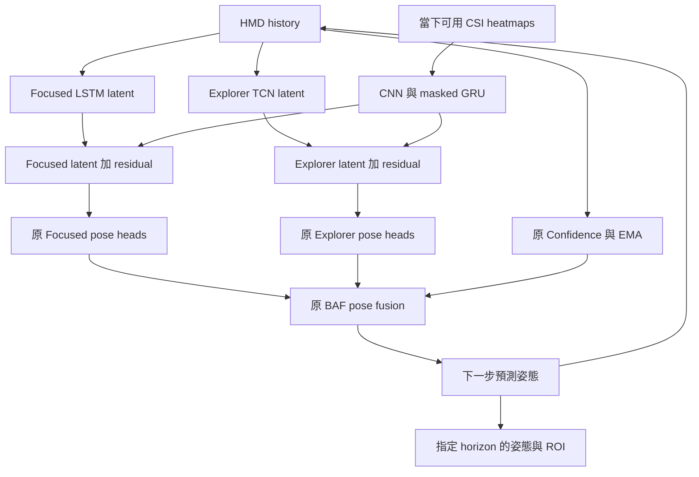

# CSI 在 BAF 內部協助預測：Feature Residual

本分支：`feature/csi-internal-residual`。基底：`feature/csi-heatmap-fusion` 的 `e34a83687390771b25438874b78f164db1a99b47`。

主要方法：`baf_roi_heatmap_residual`。

## 1. 這次重新定義了什麼

研究問題仍是：**在相同 HMD history 下，決策當下已經可取得的 CSI heatmap，能否補充 BAF 原本沒有使用的訊息，改善未來 ROI／partition selection？**

本次把 residual 放在 BAF 專家的內部特徵。Focused 的 LSTM、Explorer 的 TCN 先形成各自的 HMD 表徵；CSI 根據這個表徵提供補充；原本的姿態輸出層再產生預測。這個操作發生在每一個自回歸步驟，生成的姿態也會影響下一步的 history。

三種做法的作用點不同：

| 方法 | CSI 作用點 | CSI 能改變的內容 |
|---|---|---|
| 舊 `baf_roi_heatmap`／`residual` | 完成各 horizon 的 BAF 預測之後 | 對預測位置／旋轉加修正量 |
| `baf_roi_heatmap_alpha` | 每一步 Focused／Explorer 的融合權重 | 調整兩個專家的混合比例 |
| **新 `baf_roi_heatmap_residual`** | **每一步兩個專家的 latent，位於原姿態輸出層之前** | **讓每個專家使用 CSI 補充後的表徵來生成姿態** |

舊方法在數學上仍可稱為 residual learning；它回答的是「完成預測後能否校正」。本分支要研究的是「CSI 能否參與 BAF 的預測形成過程」。在固定同一步 history 時，alpha-only 只改兩個既有 expert 輸出的混合比例，不能直接補充該步 expert latent；它仍可透過預測回饋間接影響後續 latent。本次選擇直接作用於 expert latent 的 feature residual。

## 2. 模型怎麼運作



圖中的回饋只存在於這次 forecast 內。預測出的姿態不會寫回真實觀測 history；下一個真實決策時間仍使用新收到的 HMD 觀測。

### 2.1 Heatmap context

沿用既有因果資料介面，預設輸入為 8 個 query frames、3 個數值通道、24×24 空間網格。三個通道是 level、背景差分、時間差分。實際有效 frame 由 mask、資料產生／可取得時間、raw support 與 age 規則決定。

新的 RF encoder 使用兩層 CNN，保留 2×2 的粗空間排列，再將每個 frame 的特徵與 timing 交給 masked GRU。這保留了部分 angle–delay 空間結構與時間順序；不是將整張圖化成單一活動強度，也不是沿用 alpha 方法的八個統計量。編碼結果為預設 32 維的 context：

\[
c_t=E_{\mathrm{CSI}}(M_{\leq t},\,\mathrm{mask},\,\mathrm{timing}).
\]

每個 observed origin 只編碼一次。向未來 rollout 時使用相同的已知 context，**不讀取未來 heatmap**。每一步的 residual 仍可不同，因為它也取決於該步的 BAF latent 與 elapsed time。

AoA／ToF bins 不是直接的 HMD 世界座標。本模型透過訓練學習 heatmap 與動作的關聯，沒有假設能從某個亮點直接讀出頭的位置、轉向或身體部位。

### 2.2 Residual 的定義

對 expert \(e\in\{F,E\}\)、rollout step \(k\)，原 BAF encoder 產生 \(z_{e,k}\)。令 \(m_t\) 表示該 origin 是否有符合資料契約的 RF，則：

\[
s_{e,k}=\max\left(\operatorname{RMS}(z_{e,k}).\operatorname{detach}(),10^{-6}\right),
\]

\[
\Delta z_{e,k}=m_t\,\beta s_{e,k}\,
\tanh\!\left(A_e([\operatorname{LN}(z_{e,k}),c_t,(k+1)/30])\right),
\]

\[
\widetilde z_{e,k}=z_{e,k}+\Delta z_{e,k}.
\]

兩個 expert 使用不同的 residual heads。預設 \(\beta=0.1\)，每個 residual head 的 bottleneck 為 32。Focused 原有 latent 經過 LayerNorm，Explorer 的 latent 沒有；使用各自的 RMS 作尺度，可避免同一個絕對數值限制對兩個分支代表完全不同的介入幅度。`detach()` 只用在這個尺度項，其餘表徵與 rollout 保留梯度。

每個 residual coordinate 的絕對值不超過 \(\beta s_{e,k}\)。忽略 near-zero floor 時，也有 \(\|\Delta z\|_2\leq\beta\|z\|_2\)。這是**特徵擾動限制**，不能解讀成最終位置誤差不超過 10%、轉角不超過某個值，或 1000 ms 預測不會累積偏差。

`A_F`、`A_E` 最後的線性投影都從零初始化，因此初始 \(\Delta z=0\)。模型從保留 BAF 行為的狀態開始學習，而非一開始就任意改寫姿態。

### 2.3 原 BAF heads 產生姿態

使用原有的 translation head、rotation head 及 quaternion 重建：

\[
(\widehat p^F_{k+1},\widehat q^F_{k+1})=D_F(\widetilde z_{F,k},\widehat x_k),
\]

\[
(\widehat p^E_{k+1},\widehat q^E_{k+1})=D_E(\widetilde z_{E,k},\widehat x_k).
\]

BAF 本身的 pose head 也含 translation／quaternion residual reconstruction。這與本次新增的 **CSI latent residual** 是不同層次，文件與程式有分開命名。新 CSI 模組不輸出公尺或旋轉角度的校正量。

接著沿用 BAF 的融合：

\[
\widehat p_{k+1}=(1-\alpha_k)\widehat p^F_{k+1}+\alpha_k\widehat p^E_{k+1},
\qquad
\widehat q_{k+1}=\operatorname{SLERP}(\widehat q^F_{k+1},\widehat q^E_{k+1},\alpha_k).
\]

α=0 代表 Focused；α=1 代表 Explorer。Confidence 的模型權重與 EMA 規則不改。第一步使用真實 observed history 的 EMA；後續步使用當次生成的 history 更新。因為 CSI 會改變預測 history，後續的 confidence／α 也可能間接改變，這是正常的閉合預測流程，不等於另加一個 CSI alpha gate。

## 3. 為什麼這次確實在 BAF 裡面

核心位置是 `baf_roi_heatmap_residual/model.py` 的 `InternalResidualFusion._expert_step()`。計算順序為：

```python
latent = original_expert_encoder(pose_history)
assisted_latent = latent + csi_conditioned_residual(latent, rf_context, elapsed_s)
translation = original_translation_head(assisted_latent)
rotation = original_rotation_head(assisted_latent)
```

Focus／Explorer 各自產生的姿態經 fusion 後，才進入下一個 history window。程式沒有先呼叫原 expert 的完整 `forward()` 再修正姿態；它直接使用原 expert 的 encoder 與 heads，把插入點明確放在兩者之間。`vendor/` 和原 BAF source 保留不動，以便做來源 audit。

`runtime.predict_dataset_batch()` 使用白名單，只傳入 `maps`、`mask`、`timing`、`rf_available`、`horizon_s`、`alpha` 及 HMD history。**`base_p`、`base_q`、完成的 Focused／Explorer endpoints、target pose、ROI label 都不是新模型輸入。**

線上 `HeatmapResidualPredictor` 先取得 observed confidence／EMA，接著直接呼叫一次融合模型。缺少 RF 或整個 residual 還是零初始化時，走原 BAF 的替代執行路徑。有效的非零 residual 不需要先完成一份 baseline forecast。

共用 `prepared/` 仍儲存 baseline endpoints，原因是舊比較組、逐 origin 配對評估及 exact fallback 需要相同參考值。它們只在評估輸出邊界使用；**離線預先算 baseline 參考，不代表新模型要依賴 baseline 的預測結果才能運作。**

## 4. 訓練什麼，以及為什麼先凍結 BAF

第一個控制實驗凍結 Confidence、Focused、Explorer 的既有權重，訓練 RF encoder 與兩個 latent residual heads。預設新增 **29,808 個可訓練參數**。這是本次程式結構的參數量，並非即時效能估計。

凍結權重與停止梯度不同。BAF modules 保持 eval mode，以保留原本的 dropout／normalization 行為；但前向運算仍在 autograd graph 中。Loss 可以穿過原 pose heads、前面步驟生成的 history 與後續 encoders 回到 CSI 模組。若在這裡用 `no_grad()` 切斷 BAF，就無法正確學習對後續 rollout 的影響，本次沒有這樣處理。

這樣可以先測「同一個 BAF 增加 CSI 特徵後是否有幫助」，避免把 BAF 全面重訓帶來的改善混成 CSI 的效果。它不保證 frozen heads 足以利用所有 RF 資訊；若實驗顯示受限，再另外設計微調實驗，不能把不同訓練條件混進本輪主比較。

代價是訓練較重：舊 output adapter 可以讀取已快取的 BAF endpoints；內部 residual 必須在每個 batch 重新執行 BAF rollout，並保留跨步梯度。凍結 BAF 不代表省掉這些運算或 activation memory。較長 horizon、較大 batch 會增加成本。線上則只需一次 assisted rollout，RF encoder 也只執行一次；實際延遲仍須在部署硬體量測。

預設使用既有 `roi_iou` differentiable surrogate，加上 normalized feature residual 的正則項；以 train split 更新，使用 valid split 的 **recording-macro hard Mean IoU** 選 checkpoint，各 trained horizon 等權。預設 loss 也採 recording aggregation，避免長錄影以較多 origins 取得過多權重。共同主表仍同時提供 pooled／recording macro／scenario macro，須區分它們的定義。

Epoch 0 也參與 checkpoint 選擇。如果所有已訓練 epochs 都沒有改善 validation 指標，`residual.pt` 可以保留零 residual。這應報告為「validation 選擇保留 baseline」，不能誤稱沒有訓練，或為了顯示差異就改用 test 挑選模型。`best_trained.pt` 與 `last.pt` 另外保留作診斷。

## 5. 因果、缺測與狀態

- RF 只使用決策時間已可取得的 maps，並沿用既有 raw support、availability、clock uncertainty、max age 規則；不是只檢查名義 timestamp。
- Heatmap normalizer 只由 train RF 擬合；split、共同 origins、horizons、scene、partition ordering 共用原 evaluator。
- Masked frame 在 CNN 前就會清零，timing 也一併遮罩；padding／缺測的 NaN 不能污染有效資料或反向梯度。
- 缺測、過期 RF 時回到原 BAF。Residual 全零初始化時也走原 BAF 路徑，保留原幾何邊界行為。
- 非零模型若對某個輸入剛好產生全零 residual，線上／離線都保留該次 Torch rollout，避免為了稀有 cancellation 再計算第二次 baseline。其數學模型與 BAF 一致，與 NumPy 路徑可能有浮點差異。
- 真正持續的 stream state 只有 observed HMD confidence EMA。模型生成的 future pose／alpha、RF context 均只屬於本次 forecast；RF 中斷時不會帶著之前的 CSI 修正繼續跑。
- Stream timestamp 必須遞增；超過原 max-gap 即重設 EMA。失敗的呼叫不提交狀態，可修正資料後重試。
- Residual 依賴每一步 elapsed time，而非 requested maximum horizon。因此一起預測 `[50,250,1000]` 與只要 `[50,250]` 時，共同 horizon 應相同。

## 6. 如何執行

所有指令從 repository 根目錄執行，先進入既有的 `bafroi` Python 環境。

### 6.1 直接使用 20261031 recordings

```bash
bash scripts/train_csi_internal_residual.sh
```

這個 launcher 在背景跑 BAF、Motion Transformer 與新方法，印出 PID、output 與 log。它已使用 `nohup`，不需要再包一層。機器設定與實際 `RUN_ROOT` 沿用 `scripts/train_csi_20261031.sh`；本次不改既有資料位置。完整的直接前景指令為：

```bash
python scripts/run_experiments.py \
  --config configs/recorded_20261031.json \
  --method baf_roi motion_transformer_roi baf_roi_heatmap_residual \
  --output runs/internal_residual_01
```

20261031 profile 預設為 50–1000 ms、每 50 ms 一點，沿用記錄的 train／valid／test split。只選新方法仍需訓練或載入 BAF；那是取得初始權重的訓練階段，不是推論時做輸出修正。

### 6.2 已經有舊實驗的 prepared

```bash
python scripts/run_experiments.py \
  --prepared /absolute/path/to/previous_run/prepared \
  --method baf_roi baf_roi_heatmap_residual \
  --output runs/internal_residual_reuse_01
```

`/absolute/path/to/previous_run/prepared` 必須換成實際路徑。此命令直接重用既有 cache、RF 配對及 frozen BAF，重新訓練 CSI feature residual。舊 `adapter.pt`／`alpha.pt` 的架構不同，不能直接載入為新模型。

### 6.3 調整新方法的設定

| 參數 | 預設 | 用途 |
|---|---:|---|
| `--residual-epochs` | 沿用 heatmap epochs，recorded profile 為 20 | 新增模組的訓練 epochs |
| `--residual-hidden` | 32 | RF context 維度 |
| `--residual-bottleneck` | 32 | 各 latent residual head 的隱藏維度 |
| `--residual-max-relative-delta` | 0.1 | 相對 latent RMS 的幅度上限 |
| `--residual-modality` | `rf` | `hmd` 用於沒有 RF context 的 residual-head 控制 |
| `--residual-ablation` | `full` | RF representation 控制 |
| `--residual-aggregation` | `recording` | loss 用 recording 或 origin 權重 |
| `--residual-checkpoint` | 無 | 重用本方法且屬於相同 prepared experiment 的 checkpoint |
| `--heatmap-objective` | `roi_iou` | 共用的 loss 選項；也可明確選 `pose_roi` |

`--modality`、`--hidden` 是舊 post-forecast adapter 的參數；新方法使用上表 `--residual-*` 的明確名稱。資料 preparation 設定不由這些模型參數改寫。

### 6.4 結果、重評與繪圖

主要輸出位於：

- `models/baf_roi_heatmap_residual/residual.pt`：validation 選出的模型，可能是 epoch 0。
- `models/baf_roi_heatmap_residual/best_trained.pt`：epoch ≥1 中 validation 最好的模型，供診斷。
- `models/baf_roi_heatmap_residual/training.json`：參數設定、每個 epoch 的 loss／validation、選擇狀態。
- `evaluations/test/baf_roi_heatmap_residual/report.json`、`per_origin.csv`：共用評估與逐 origin 結果。
- `summary.csv`、`summary.json`：各選取方法的配對比較。

```bash
python scripts/run_experiments.py evaluate \
  --run runs/internal_residual_01 --output runs/internal_residual_eval_02

python scripts/plot_evaluation.py --path runs/internal_residual_01
```

圖表會區分 `internal CSI residual` 與歷史 `post-forecast residual`。共同入口省略 `--method` 仍會執行全部五種方法，包含歷史比較組；本分支主 launcher 已明確指定主要三組。

## 7. 怎麼判斷改善是否來自 CSI

第一輪主比較使用同一個 BAF checkpoint、origins、split 與 geometry，比較原 BAF、新內部 CSI residual；Motion Transformer 為另一個 history-only baseline。接著至少檢查下列控制：

| 控制 | 執行設定 | 可以回答的問題 |
|---|---|---|
| HMD residual-head control | `--residual-modality hmd` | 只增加 latent adaptation，而沒有 RF，是否已能解釋改善？ |
| RF metadata-only | `--residual-ablation metadata_only` | 優勢是否主要來自 mask／timing，而非 heatmap 內容？ |
| 空間平均 | `--residual-ablation spatial_mean` | Heatmap 的空間結構是否有用？ |
| 單幀 | `--residual-ablation last_frame` | 多幀順序與變化是否有額外作用？ |
| Alpha-only | `--method baf_roi baf_roi_heatmap_alpha baf_roi_heatmap_residual` | 修改 expert features 是否優於只改混合比例？ |
| 舊 output residual | 明確加入 `--method baf_roi_heatmap` | 內部融合與完成後修正的差異為何？ |

每一種控制都應重新訓練自己的模型，使用相同資料／seed／選模規則。HMD control 保留同樣的 residual-head 結構與整體 module 定義，但 RF encoder 不啟用，因此不能宣稱有效可訓練參數完全相同。RF metadata-only 控制對辨識「RF 內容是否有用」也很重要。HMD control 在沒有 RF 的 origins 仍能運作，因此除了 all origins，也要比較共用的 RF-available subset。

例如重用 prepared 跑 HMD 控制：

```bash
python scripts/run_experiments.py \
  --prepared /absolute/path/to/previous_run/prepared \
  --method baf_roi baf_roi_heatmap_residual \
  --residual-modality hmd \
  --output runs/internal_hmd_control_01
```

讀表時同時看各 horizon 的 Mean IoU、F1、precision、coverage/recall、FP/FN、selected partitions 及 pose error。多選 partitions 可能提高 coverage；只看一個指標不能證明「選得更精確並維持畫質」。Rendered visual quality／SSIM 需要同一 future pose、內容、renderer 的實際影像，現有幾何 evaluator 不會偽造這個結論。

## 8. 此次交付的證據邊界

此處提出的是符合研究意圖、已實作的內部 residual 架構。軟體測試證明插入點、梯度、因果輸入、缺測處理、單次線上 rollout 與訓練／評估整合；不能以此證明真實 CSI 提升 ROI、保證 30 Hz 或宣稱論文新穎性。真實資料與訓練機器上的 CUDA 效能需要另外量測。

本分支也沒有重寫 MUSIC 物理模型、假設新增校正資料，或改動既有 20261031 split。資料有效性仍受既有 heatmap 產生方式、RF↔HMD 時間校正與 RF coverage 限制。

具體驗證命令與實測結果見 [INTERNAL_RESIDUAL_VALIDATION.md](INTERNAL_RESIDUAL_VALIDATION.md)。

## 9. 與既有研究概念的關係

- He et al., *Deep Residual Learning for Image Recognition*：residual function 可以定義在 network features 上，而不限於最終輸出的錯誤校正。[原論文](https://arxiv.org/abs/1512.03385)
- Perez et al., *FiLM: Visual Reasoning with a General Conditioning Layer*：條件資訊可以透過特徵調制影響網路內部運算。[原論文](https://arxiv.org/abs/1709.07871)

以上只是設計概念的來源。這份程式是針對本 repo 的雙 expert、因果 RF 與 autoregressive ROI 任務設計的 additive latent residual；它不是 FiLM 原式的完整重現，也不以引用這些工作代替本研究的實驗證據。
