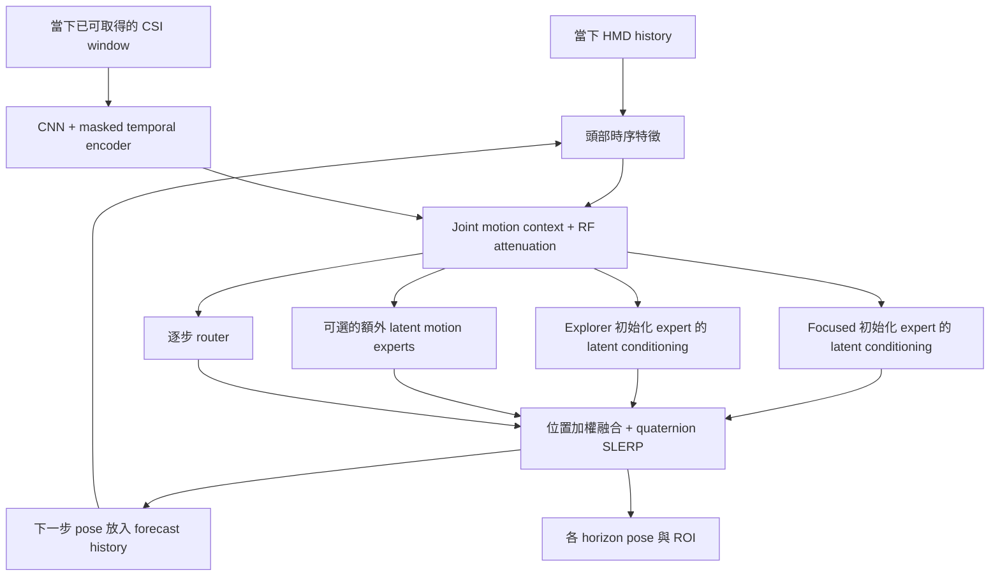

# CSI-conditioned BAF motion experts

## 研究假設與 1122 評估

BAF 用 HMD history 建立 Focused／Explorer 預測與行為 confidence。現有 supervision 由頭部平移與旋轉的規則產生，不是完整人體動作標註。研究假設是：相似的 HMD history 可能隱藏不同的身體動態；CSI 能否補充對 future HMD／ROI 有用的資訊，並改變 expert 內部的預測與分工？CSI 有變化不代表未來頭部一定改變，也不把 heatmap peaks 直接命名為身體部位。

`baf_roi_eval_1122/` 是舊模型的 test 評估。Margin 0、20 個 horizons 等權平均：

| 指標 | BAF | 舊 residual | alpha-only |
|---|---:|---:|---:|
| Mean IoU | 66.82% | 67.57% | 66.99% |
| 各 horizon micro F1 平均 | 74.97% | 74.75% | 75.08% |
| 各 horizon micro coverage 平均 | 78.20% | 73.99% | 78.16% |
| 平均位置誤差 | 16.39 cm | 22.13 cm | 16.27 cm |

三方法 protocol／origins／targets／RF cohort 一致，CSV 與 report 的 hash 一致。舊 residual 在 50–250 ms 的平均 IoU 都下降；較長 horizon 的收益不能抵銷短期與 coverage 退步而不加檢查。逐 origin×horizon 配對時約 41.5% 改善、43.3% 退步；事後取 BAF 與 residual 中較高 IoU 可達 71.84%，僅表示既有候選有互補性，不是新架構上限或可部署選擇器。

這些結果促使新設計取消 terminal pose correction、同時訓練 pose／ROI、逐 horizon 檢查 validation 退步；**沒有把 test 觀察到的 300 ms 分界硬編入模型，也沒有由 test 選定最佳分支數**。此 test 已參與設計，後續正式確認應另保留未參與設計的 recordings。原 cohort 只有 6 recordings、3 session groups，不能據此確立人體狀態分類或跨人泛化。

## 預設模型：motion_moe



`motion.py::MotionFusion` 實際執行每個 30-Hz step，不讀 GT 或完成的 BAF endpoints 來產生 active 預測。

1. CSI 的 level／background difference／temporal difference 以既有因果契約編碼。Spatial CNN 與 masked GRU 保留時空特徵；不是只用 8 個統計量。無效 frame 的 pixels／timing 在 encoder 前遮除。
2. 每步從更新後的 HMD history 重算 head-motion features，結合當下 origin 的 RF context、有效比例、map age 與 elapsed forecast time。學得的 RF attenuation 是特徵權重，不是校準過的「CSI 正確機率」。
3. 複製原 Focused LSTM／Explorer TCN 初始化專家。原 temporal encoders 凍結以控制小資料集上的容量；在 **native pose heads 之前**以 bounded FiLM conditioning 注入 joint context，並訓練各 expert 的位置／旋轉 heads。不是先產生 BAF future pose，再加 Δpose。
4. Router 依 joint context、原 confidence prior 與 step time 產生 K 個權重。第一個 expert 從 Focused 初始化，其餘從 Explorer 初始化；原 Explorer prior 在這些 descendants 間分配，各自的 conditioners／heads 獨立學習。原二分類標籤不限制新分工。
5. 每步位置加權融合；quaternion 使用固定順序的 cumulative SLERP：Focused、Explorer、額外 latent experts。K=2 對應原 BAF 的 SLERP；K>2 的結果依宣告順序，不宣稱是順序無關的 quaternion barycenter。融合 pose 進入下一個 history。

RF context 始終來自 origin 的已觀測 window；rollout 不取得或生成未來 CSI。HMD features 會隨預測 history 更新，elapsed time 讓同一份 RF 在不同步數有不同作用。Observed confidence EMA 仍只由真實 HMD observations 更新，forecast state 不會寫回 observed state。

預設 K=3 是可檢驗的候選，不是已證實最佳值。額外 expert 名稱為 `latent_motion_2`／`latent_motion_3`，沒有預先宣稱它代表軀幹、腳、過渡狀態或特定活動。檢查 expert usage、各 expert 勝出的樣本與同步動作註解後，才能討論語意。使用新輸入也可能讓兩個 experts 已足夠。

## 訓練與 checkpoint 選擇

新模型預設 `pose_roi`：位置 Smooth-L1、sign-invariant rotation loss、soft ROI Tversky（FP .3／FN .7），加上 latent／routing 正則化。另以訓練 GT 計算相對原 BAF 的位置、旋轉與漏選退步 penalty；GT 只供 loss 使用，不進 forward 或 online router。

訓練採 original-recording-balanced weights，避免一個長 recording 或 gap segments 壓過其他來源。新模型不沿用 head-only Focused／Explorer binary targets 來強迫分支分類。Branch 語意需另外驗證，task loss 本身不保證 experts 不塌縮。

新 RF／context／router／conditioners 使用指定的 learning rate；預訓練 pose heads 使用其 0.1 倍，降低每步 head 更新被長 rollout 放大的風險。

每 epoch 以 validation original-recording macro IoU 排序，且 **每個 horizon** 都必須符合相對 epoch-zero BAF 的限制：

| 檢查量 | 預設允許退步 | 共同入口覆寫 |
|---|---:|---|
| pooled micro coverage | 0.005，亦即 0.5 個百分點 | `--validation-coverage-drop` |
| recording-macro 平均位置誤差 | 0.005 m | `--validation-translation-increase-m` |
| recording-macro 平均旋轉誤差 | 0.5° | `--validation-rotation-increase-deg` |

這些是明示的 validation 設計容許量，不是來自 1122 test 的最佳化結果，也不是 test 非劣性保證。可全部設 0 做更嚴格選擇。每 epoch 的逐 horizon 數字、是否合格與拒絕原因都保存於 `training.json`。

`baseline_only=True` 的 epoch 0 是精確 BAF 候選。開始訓練後關閉此 flag；若沒有合格且 IoU 優於 BAF 的 epoch，`adapter.pt` 保留 epoch 0。`best_trained.pt` 仍保存最高 IoU 的已訓練 epoch，可能不合格，不能當成已通過限制的部署模型；`last.pt` 保存最後 epoch。

有效 CSI 的 online 路徑先算 HMD confidence，再直接執行新 experts；不先完整跑 BAF。RF 缺測／過期／不合規，或選中 epoch 0 時，回到原 BAF。Offline cache 內 frozen BAF outputs 用於 exact fallback、loss comparison 與 validation reference。舊 checkpoint 仍按儲存的 residual／expert_gate config 載入，不自動轉成新模型。

## 執行與 ablations

重用相同 prepared 的 HMD、RF、split、scene、horizons 與 BAF，重新訓練新的 experts：

```bash
python scripts/run_experiments.py --prepared runs/previous/prepared \
  --method baf_roi baf_roi_heatmap --motion-experts 3 \
  --output runs/motion_rf_k3
```

沒有 prepared 時，原本 `bash scripts/train_csi_20261031.sh` 或共同入口 `--config configs/recorded_20261031.json` 會使用新預設。改分支數需新 output；不用重訓 reference BAF。以下每次呼叫是一個獨立實驗：

```bash
# 只測 CSI 是否幫助 routing；原兩個 experts 全凍結。
python scripts/run_experiments.py --prepared runs/previous/prepared \
  --method baf_roi baf_roi_heatmap --motion-experts 2 --motion-conditioning router_only \
  --output runs/motion_router_rf_k2

# CSI 同時進 expert latent conditioning 與 router。
python scripts/run_experiments.py --prepared runs/previous/prepared \
  --method baf_roi baf_roi_heatmap --motion-experts 2 --output runs/motion_rf_k2

python scripts/run_experiments.py --prepared runs/previous/prepared \
  --method baf_roi baf_roi_heatmap --motion-experts 4 --output runs/motion_rf_k4

# 同 K 的 HMD-only 結構控制；完全忽略 RF pixels、mask、timing、availability。
python scripts/run_experiments.py --prepared runs/previous/prepared \
  --method baf_roi baf_roi_heatmap --motion-experts 3 --modality hmd \
  --output runs/motion_hmd_k3

# Metadata-only 仍保留 RF availability／timing；用來排除只有感測時序造成收益。
python scripts/run_experiments.py --prepared runs/previous/prepared \
  --method baf_roi baf_roi_heatmap --heatmap-ablation metadata_only \
  --output runs/motion_metadata_k3
```

K=2/3/4 均應有相同 K 的 HMD-only control；RF-only 的額外 encoder 在 HMD control 中不活躍，因此這是同結構控制，不宣稱 active parameter count 完全相同。分支數與訓練設定只依 train／validation 選擇，正式報告需跨 seeds 與未見 recordings。可另外使用既有 `--baseline focused|explorer|fixed`，檢查原 BAF routing 本身的限制。

舊 residual 仍可用 `--heatmap-adapter residual --heatmap-objective roi_iou --heatmap-aggregation origin` 重現。Package-level `python -m baf_roi_heatmap train` 同樣預設新方法，分支參數為 `--experts`／`--conditioning`。

## 新增 evaluation diagnostics

仍使用共同 evaluator，不改 origins、targets、hard ROI 或主要 IoU/F1 定義。新模型的 `per_origin.csv` 額外保存 `expert_weight_0...K-1`、`rf_reliability`。`gate_kind=motion_explorer_family_mass` 表示該 horizon 上界步驟的 Explorer-family 權重總和；fallback gate 是 observed BAF α。`correction_applied` 在新模型表示有使用 trained internal model，不是 terminal residual。

`report.json` 保存模型 config、參數量、expert 初始化名稱、checkpoint selection limits 與每個 horizon 的 active expert mean weights／winner fractions。Epoch-zero 或無 RF 時 usage 為 null，不能把沒有啟用新模型解讀成 CSI 無效。這些是分工診斷，不是人體動作辨識準確率。

若明確評估未通過 validation 限制的 `best_trained.pt`，report status 為 `validation_ineligible_epoch`，避免把診斷用 checkpoint 誤讀成已被選中。

軟體驗證使用 `tests/test_motion_fusion.py` 與 `scripts/smoke_heatmap.py`；測試包含 CSI 在固定 router 時仍改變 expert 預測、active path 不依賴完成的 BAF endpoints、RF outage exact fallback、state chronology、HMD-only invariance、梯度抵達 RF／conditioners／pose heads，以及短 horizon validation regression rejection。Synthetic smoke 只能驗證程式流程，不能宣稱新方法的真實 IoU 或 pose accuracy。
